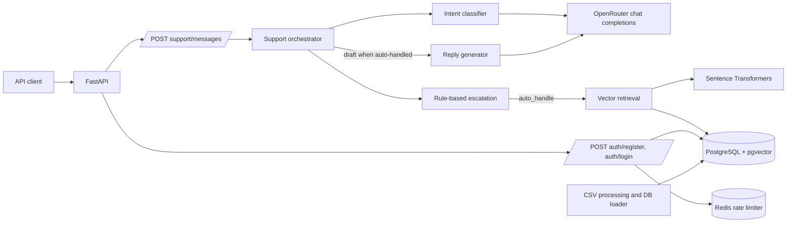

<div align="center">

<h1>SupportPilot</h1>

<h2>Apple Support, grounded in historical conversations</h2>

An experimental AI support agent that classifies incoming messages, retrieves
similar Apple Support conversations, drafts a response, and routes uncertain or
sensitive cases to a human.


</div>

> **Status:** working API and support-agent components, with a provisional
> 200-example annotation file. Headline model results, baseline comparisons,
> and an evaluation harness are not yet available. This is not an official
> Apple product and is not endorsed by Apple.

## What it does

SupportPilot explores how an AI support agent can learn from historical
customer-support conversations instead of drafting replies without evidence.
The current support endpoint:

1. Uses an OpenRouter chat-completion call to classify a message into one of
   eight Apple Support intents plus an insufficient-context label.
2. Applies deterministic escalation rules for low confidence, unknown intent,
   and Apple ID/account-security issues.
3. For auto-handle decisions, retrieves up to five nearest historical cases
   using 384-dimensional sentence embeddings and PostgreSQL `pgvector`, then
   asks the configured chat model to draft a response.

The reply is a **draft**, not an action taken on an Apple account. Retrieved
social-media conversations are historical examples, not official Apple
policies.

## Architecture



The request path and its current limitations are described in the
[technical guide](docs/TECHNICAL_GUIDE.md).

## Data and processing

The selected source is Kaggle's **Customer Support on Twitter**
(`thoughtvector/customer-support-on-twitter`). The repository's dataset notes
report 2,811,774 tweets in the full source and 106,860 tweets authored by
`AppleSupport`; these are source-dataset counts, not counts of processed
conversations or database cases. The raw CSV is local and is not committed.

The processing code uses tweet parent/child IDs to reconstruct conversation
turns and writes a Parquet file. On the inspected development workspace, that
local ignored Parquet artifact contains **5 message rows across 2 conversations**;
it is a small artifact, not evidence that the full source has been processed.
The checked-in evaluation CSV contains 200 examples. Its accompanying report
describes the set as provisional and manually reviewed, not independently
adjudicated.

See [dataset notes](docs/dataset.md) and the detailed
[data pipeline guide](docs/TECHNICAL_GUIDE.md#5-data-pipeline).

## Run a local demonstration

Prerequisites: Python 3.14 or newer (required by `pyproject.toml`), `uv`,
Docker with the Compose plugin, a private `.env` file, and an OpenRouter API
key/model to exercise the full support-message route.

On a fresh checkout, copy the example configuration once; otherwise edit the
existing local `.env` without overwriting it:

```bash
cp .env.example .env
```

Set `DATABASE_URL`, `POSTGRES_PASSWORD`, `REDIS_URL`, and a strong
`JWT_SECRET_KEY`. To call the LLM-backed support route, also set
`OPENROUTER_API_KEY` and `MODEL` (the code reads `MODEL`). Keep real credentials
out of version control. The Compose file publishes PostgreSQL on host port
`5433` and names its database `supportpilot`; make `DATABASE_URL` match that
host-side configuration. The checked-in example currently points at
`supportpilot_test` on port `5432` and does not define all the variables needed
for a complete local run.

```bash
uv sync --locked
./dev.sh infra
uv run alembic upgrade head
./dev.sh server
```

In another terminal, verify the running API:

```bash
curl -fsS http://127.0.0.1:8000/health
curl -fsS http://127.0.0.1:8000/ready
```

Both health routes currently return static status responses; `/ready` does
not test PostgreSQL, Redis, the embedding model, or the LLM provider. The
full `/support/messages` flow additionally needs a configured provider and
historical cases with embeddings. For exact API schemas, current test commands,
and setup caveats, see the [technical guide](docs/TECHNICAL_GUIDE.md).

## API at a glance

The routers live under `app/api/v1/`, but they are included without a version
prefix: the actual paths are `/auth/...` and `/support/messages`.

| Method | Path | Purpose | Authentication |
|---|---|---|---|
| `GET` | `/health` | Liveness response | None |
| `GET` | `/ready` | Static readiness response | None |
| `POST` | `/auth/register` | Create a user | None; Redis rate limited |
| `POST` | `/auth/login` | Authenticate and issue a JWT | None; Redis rate limited |
| `POST` | `/support/messages` | Classify, route, and optionally draft a reply | No auth dependency currently applied |

The generated OpenAPI page is available at `/docs` while the app is running.
This endpoint inventory is not a claim of production readiness; in particular,
the current support route is not protected by the JWT helper.

## Evaluation: evidence and open work

| Assignment requirement | Current evidence |
|---|---|
| Apple Support intent taxonomy | Implemented in the classifier schema and documented in [`docs/intent_taxonomy.md`](docs/intent_taxonomy.md). |
| Golden examples | A checked-in 200-row CSV and validation/methodology documents exist. Labels are provisional; the sampling script and documented paths/names do not fully line up. |
| Intent/escalation behavior | Implemented and covered by unit tests; this is code/test evidence, not a benchmark score. |
| Historical retrieval and response drafting | Implemented in the request path; requires populated vector data and an external LLM configuration. |
| Trivial and simple baselines | No baseline evaluation implementation or result found. |
| LLM-as-judge and human agreement | No judge rubric, judge runner, or agreement result found. |
| Five example-backed failure modes | No completed failure-analysis report found. |
| “What is misleading about my headline number?” | There is no headline performance number yet. The 200-row annotation count is a dataset size, not an accuracy or reliability result. |
| 10–15 decision log | No grounded decision-log artifact found. |
| Reproducible headline results in under 15 minutes | Not established; the current repository does not contain an evaluation runner/results to reproduce. |

### What is misleading about my headline number?

There is no model-performance headline number to report yet. The tempting
“200 examples” figure counts rows in a curated, difficulty-enriched, provisionally
reviewed annotation file. It is not a random production sample, does not show
that predictions are correct, and cannot stand in for baseline comparisons,
per-intent metrics, escalation error rates, or reply-quality evaluation.

The repository also does not yet contain an evaluation runner that connects
those labels to predictions and reports those metrics. Therefore, no accuracy,
F1, retrieval-quality, latency, or LLM-judge agreement result is claimed here.

### With one additional week

I would first reconcile the runtime intent labels and the golden-set
generation/documentation paths, then freeze a reviewed evaluation split. I
would build a reproducible runner with trivial and simple baselines, report
per-intent and escalation metrics, add a reply-quality rubric with a
human-agreement check, and document five real failure examples. The final
iteration would make the headline evaluation reproducible from a clean setup
and record engineering decisions from evidence rather than reconstructing
them after the fact.

## Development checks

The CI workflow currently runs dependency sync, database migrations, Ruff lint
and format checks, and Pyright. It does **not** run pytest. Locally, the focused
tests used during this documentation update passed, including the health,
orchestrator, escalation, retrieval, embedding, security, database, and Redis
rate-limit checks. The standalone unit and integration commands (including
the integration test import-path workaround) are in the
[technical guide](docs/TECHNICAL_GUIDE.md#10-testing-and-ci).

## Data attribution

Source tweets come from Kaggle's
[Customer Support on Twitter dataset](https://www.kaggle.com/datasets/thoughtvector/customer-support-on-twitter).
Processed conversations, historical-case rows, annotations, embeddings, and
drafts are project-generated artifacts. Consult the dataset's terms before
redistributing source-derived data. SupportPilot is an independent project;
Apple and Apple Support are not affiliated with or endorsing it.